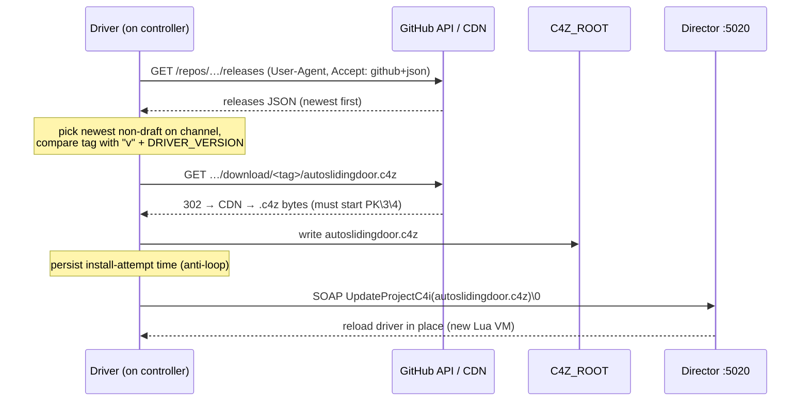
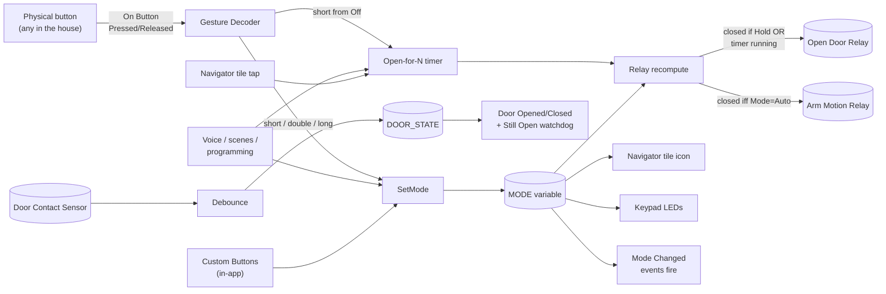

# Auto Sliding Door

A Control4 DriverWorks driver that turns a motion-sensor-enabled sliding door — wired with two relays and a contact sensor — into a single experience-button device with three sustained modes and a clean programming surface.

<table>
  <tr>
    <td align="center"><br><b>Off</b><br>Door closed<br>Motion disarmed</td>
    <td align="center"><br><b>Hold</b><br>Held open<br>Motion disarmed</td>
    <td align="center"><br><b>Auto</b><br>Door closed<br>Motion sensors armed</td>
  </tr>
</table>

[](https://github.com/mattstein111/control4-autoslidingdoor/releases/latest)
[](https://github.com/mattstein111/control4-autoslidingdoor/releases)
[](LICENSE)
[](https://www.control4.com/os3/)

## At a glance

- **One experience-button device** instead of two raw relays + a contact sensor
- **Three modes:** `Off` / `Hold` / `Auto` — single canonical state variable
- **Built-in gesture decoder** turns any physical button in the house into a single/double/long-press controller with two lines of programming
- **Mode-aware Navigator tile** swaps gray / amber / green to show current mode at a glance
- **In-app mode selection** via the C4 Custom Buttons agent
- **Tunable everything** — open duration, Hold auto-release, gesture thresholds, contact debounce, per-mode keypad LED colors
- **Relay & contact inversion** built in (works with NO and NC wiring)
- **Self-updating** (opt-in) from GitHub Releases, with no Composer visit per release

## Table of contents

<details>
<summary>Expand</summary>

- [Why this driver](#why-this-driver)
- [Install](#install)
- [Auto Update](#auto-update)
- [Configure](#configure)
- [Programming recipes](#programming-recipes)
  - [Drive the door from any physical button](#drive-the-door-from-any-physical-button-in-the-house)
  - [In-app mode selection (Custom Buttons)](#in-app-mode-selection-via-custom-buttons)
  - [React to mode changes](#react-to-mode-changes-announcements-lights-etc)
  - [Watchdog: nag if left open](#watchdog-nag-if-the-door-is-left-open)
  - [Doorbell → timed open](#doorbell-triggers-a-timed-open)
  - [Voice integration](#voice--open-the-back-door)
  - [Custom gesture decoder (advanced)](#advanced-roll-your-own-gesture-decoder)
- [Navigator app behavior](#navigator-app-behavior)
- [Reference](#reference)
- [How it works (internals)](#how-it-works-internals)
- [Troubleshooting](#troubleshooting)
- [Develop & contribute](#develop--contribute)
- [Credits](#credits)

</details>

---

## Why this driver

A sliding door with a built-in motion-detection module is typically wired into Control4 with three signals:

| Wire | Direction | Behavior |
|---|---|---|
| **Open Door relay** | C4 → door | Closed = slide open. Open = slide closed. Hold closed to keep open. |
| **Arm Motion relay** | C4 → door | Closed = motion sensors armed. They then trigger door open on their own. |
| **Door Contact sensor** | door → C4 | Reports actual door position. |

Without this driver, an integrator typically exposes each relay as a standalone device and writes ad-hoc programming on top. The result is three loosely-coupled controls that don't reflect *mode* as a first-class concept.

This driver collapses everything into one experience-button device with a real state model — `Off / Hold / Auto` as the canonical mode plus a one-shot `Open Door` action — and gives Composer programming clean hooks (Actions, Events, Conditions, Variables) to react to mode changes from announcements, lights, voice, scenes, or any button anywhere in the house.

### Mode behavior

| Mode | Open Door relay | Arm Motion relay | Door behavior |
|---|---|---|---|
| **Off** | open | open | Door closes; motion disarmed |
| **Hold** | closed | open | Door held open until released (or until `Hold Duration` elapses, if set) |
| **Auto** | open | closed | Motion sensors armed — door auto-opens on motion, auto-closes when motion ends |

Both relays are recomputed from state on every transition. The rule is intentionally tiny:

```
Open Door relay closed  =  (MODE = Hold)  OR  (Open-for-N timer is running)
Arm Motion relay closed =  (MODE = Auto)
```

This means Hold and `Open for N` compose cleanly. Calling `Open for N` while in Hold is harmless (relay's already closed). A mode change always recomputes outputs from scratch — no state divergence.

---

## Install

### Option A — download a release

1. Grab `autoslidingdoor.c4z` from the latest [release](https://github.com/mattstein111/control4-autoslidingdoor/releases/latest)
2. Composer → **System Design → Search Drivers → Add Driver from File** → pick the `.c4z`
3. Drag the **Auto Sliding Door** driver into a room
4. Wire connections (see [Configure → Wiring](#wiring) below)
5. Show the tile in Navigator: **Room Properties → Navigator Tab → Device Visibility**

### Option B — build from source

```sh
git clone https://github.com/mattstein111/control4-autoslidingdoor.git
cd control4-autoslidingdoor
./build.sh
```

Produces `autoslidingdoor.c4z` at the repo root. Then follow Option A from step 2.

Build dependencies: `zip`, `xmllint`, `luac`. Re-rendering icons additionally needs `rsvg-convert` (`brew install librsvg`).

### Hardware requirements

- Control4 OS 2.9.0 or later (tested on OS 3.4.x with EA-5)
- A controller with **2 relay outputs** and **1 contact-sensor input** available
- The sliding door must accept dry-contact closures on both control inputs and provide a dry-contact position sensor

The driver is hardware-agnostic on relay and sensor implementation — wire it to whatever physical relays/sensors your controller exposes.

---

## Auto Update

From v2.2.0-beta.1 the driver can update itself from this repo's [GitHub Releases](https://github.com/mattstein111/control4-autoslidingdoor/releases). You install it once through Composer; after that, new releases install themselves with no Composer visit, keeping bindings, properties and programming.

### Channels (`Auto Update` property)

| Setting | Behaviour |
|---|---|
| **Off** *(default)* | Never checks automatically, never installs automatically. **Check for Updates Now** still reports the newest stable release. |
| **Beta** | Checks at startup, when the setting changes, and every 24 hours. Installs the **highest** newer release, prereleases (any tag with a `-`, e.g. `-beta.2`, `-rc.1`) included. |
| **Release** | Same, but stable releases only. |

### Actions (Composer → device → Actions tab)

| Action | What it does |
|---|---|
| **Check for Updates Now** | Checks immediately. If `Auto Update` is Beta/Release and something newer exists, installs it, even within the 5-minute anti-loop window (this is the explicit retry). When Off it only reports, against the Release channel. |
| **Install Latest Release (Force)** | Reinstalls the channel's latest release (Release when Off) **even if it's the version already running**, to repair a damaged install or retry a failed one. It **refuses an older version**: a downgrade could land on a release without the updater (e.g. v2.0.1) and strand the device until a Composer visit. Downgrade through Composer if you really need to. |

### Status (read-only properties)

| Property | Shows |
|---|---|
| `Driver Version` | The running version (e.g. `2.2.0-beta.1`) |
| `Latest Available Version` | Newest tag found on the channel at the last check, or `(none)` |
| `Update Download URL` | Release page of a newer version, when there is one |
| `Last Update Check` | Time of the last check and its outcome: `up to date (…)`, `update available: …`, `installing …`, `check failed: HTTP 403`, … |

### How it works



### Safety rails

- **Off by default.** Nothing is downloaded until you choose a channel.
- **Complete-file check.** Before anything is written, the download must start with the ZIP signature, end with a ZIP end-of-archive record, and match the asset size GitHub reports. An HTML error page or a truncated transfer can never overwrite the driver. If the write fails, no reload is requested.
- **Anti-loop guard.** For 5 minutes after an install attempt, every *automatic* path (boot, 24h timer, setting change) declines to install. Usually the restart *is* the install; if an install failed and left the old version running, it won't retry in a loop. **Check for Updates Now** and **Install Latest Release (Force)** bypass it on purpose.
- **One install at a time.** A second trigger while a download is in flight is ignored.
- **Never downgrades.** Automatic installs need a strictly newer tag; Force allows equal but never older. Ordering: `v2.2.0` > `v2.2.0-rc.1` > `v2.2.0-beta.10` > `v2.2.0-beta.9`; any number of parts (`0.9.1.9` > `0.9.1.8`); `v`/`V` and prerelease case don't matter; `+build` metadata is ignored.
- **Highest, not latest.** The channel's highest version wins, so a stable hotfix published after a beta doesn't hide the beta from the Beta channel.

### Requirements

- Controller can reach `api.github.com` and `github.com` over HTTPS. GitHub allows 60 anonymous API calls per hour per IP, far above one check a day.
- The installed driver file must be named **`autoslidingdoor.c4z`** (the name the release asset has). Director reloads by filename.
- Unsigned community driver: the self-install relies on the `FileSetDir` handshake described in `c4-conventions.md` §3a (finitelabs/esphome), done once at startup.

---

## Configure

### Wiring

In **Composer → Connections → Control/AV**:

| Connection | Bind to | Required |
|---|---|---|
| `Open Door Relay` | The physical relay output controlling the door's open trigger | **Yes** |
| `Arm Motion Relay` | The physical relay output that arms the door's motion sensors | **Yes** |
| `Door Contact` | The contact sensor on the door | Recommended — without it, `DOOR_STATE` stays `Unknown` and door events don't fire |
| `Open` / `Off` / `Hold` / `Auto` (BUTTON_LINK) | A keypad button you want auto-bound to that action | Optional |

The BUTTON_LINK targets are for Composer's drag-to-bind keypad workflow. They're `autobind=False`, so they don't appear unless you actively use them. Most installations skip them and use programming on a button press calling the driver's actions — more flexible (and what the [gesture decoder recipe](#drive-the-door-from-any-physical-button-in-the-house) below uses).

### Properties (overview)

The properties you'll touch most often:

| Property | What it does | Default |
|---|---|---|
| `Default Open Duration (s)` | How long Relay A is held closed by the `Open Door` action | 5 |
| `Long Press Threshold (ms)` | How long a button must be held before the gesture decoder fires Hold | 1000 |
| `Double Click Window (ms)` | How long the gesture decoder waits for a second press | 400 |
| `Hold Duration (s)` | Safety auto-release for Hold mode (0 = unlimited) | 0 |
| `Still Open Time (s)` | Fires `Still Open` event after door has been open this long (0 = disabled) | 0 |
| `Debug Mode` | Verbose Lua output for troubleshooting | Off |

Full property reference: [Properties table](#properties).

---

## Programming recipes

### Drive the door from any physical button in the house

The driver's built-in gesture decoder means **any** Control4-visible button — a keypad button, an SR-260 remote button, an in-wall button from a third-party driver — can drive the door with two one-line program calls. No timers, no custom variables, no state machines in your programming.

In Composer's Programming tab, on the button you want to use:

| Button event | Action to call |
|---|---|
| When Button is **Pressed** | Auto Sliding Door → **On Button Pressed** |
| When Button is **Released** | Auto Sliding Door → **On Button Released** |

That's it for each button. The driver decodes:

| Gesture | Effect |
|---|---|
| Short press, Mode = Off | **Open Door** (default duration) |
| Short press, Mode = Hold or Auto | **Set Mode to Off** (releases the held / auto state) |
| Two short presses within Double Click Window | **Set Mode to Auto** |
| Held past Long Press Threshold | **Set Mode to Hold** — fires the moment the threshold elapses, before release |

Repeat the two-line wiring on every button you want to drive the door (front entrance, kitchen wall button, master bedroom keypad — same two actions everywhere). All buttons share the same `Long Press Threshold` and `Double Click Window` properties, so the timing feel is consistent across the house.

### In-app mode selection via Custom Buttons

The main Navigator tile is dedicated to "Open Door" (see [Navigator app behavior](#navigator-app-behavior)). For changing **mode** from inside the Control4 iOS app, use the **Custom Buttons** agent:

#### Setup in Composer

1. **Programming tab → click the room** in the device tree
2. Right pane → **Agents → Add Agent → Custom Buttons** (if not already added)
3. With Custom Buttons selected, in the **Screen 1** area click **Add**
4. **Name:** `Auto Mode` (or whatever you'd like the button labeled)
5. Click the new button row → in the right pane (button programming), add:
   - When this button is selected → Auto Sliding Door → **Set Mode to Auto (Motion Sensors)**
6. Click **Add** again → name `Hold Open` → action: **Set Mode to Hold (Hold Open)**
7. Click **Add** again → name `Off` → action: **Set Mode to Off**
8. Save

#### Where they appear in the Navigator app

1. In the iOS / touchscreen Navigator, navigate to the room
2. Tap the **Control4 logo in the upper-left corner** of the Room screen — this opens the Room Menu
3. Look for the **Custom screens** — Custom Buttons screens appear as tabs in the Room Menu
4. Tap any button to invoke the corresponding `Set Mode to X` action

Each Custom Buttons screen holds up to 6 buttons; you can have up to 4 screens per room (24 total). Three door-mode buttons easily fit one screen.

### React to mode changes (announcements, lights, etc.)

Hook a "Mode Changed to X" event to whatever you'd like:

```
When Auto Sliding Door → Mode Changed to Hold:
  - Annunciator → Play "Door held open"
  - Hue Light "Hallway" → Set color to amber

When Auto Sliding Door → Mode Changed to Auto:
  - Annunciator → Play "Door is now automatic"
  - Hue Light "Hallway" → Set color to green

When Auto Sliding Door → Mode Changed to Off:
  - Annunciator → Play "Door off"
  - Hue Light "Hallway" → Set color to blue
```

Mode-changed events fire only on actual transitions — setting the same mode that's already active is a no-op, so you won't get announcement spam from idempotent re-sets.

### Watchdog: nag if the door is left open

Set `Still Open Time (s)` to 300 (5 minutes), then:

```
When Auto Sliding Door → Still Open:
  - Annunciator → Play "The sliding door has been open for five minutes"
  - Push notification → "Door still open"
```

The watchdog only fires while `Still Open Time > 0` and only after the door has been continuously open that long. Closing the door cancels the pending watchdog.

### Doorbell triggers a timed open

```
When Doorbell → Pressed:
  - If Auto Sliding Door → Mode is Off:
      Auto Sliding Door → Open Door for 10 Seconds
```

The conditional avoids a redundant relay pulse if the door's already held open (Hold) or auto-responsive (Auto).

### Voice — "Open the back door"

Bind any voice intent (Alexa / Google / Siri via your usual C4 voice integration) to the `Open Door` action. The driver uses the configured `Default Open Duration` automatically.

### Advanced: roll your own gesture decoder

If you want different gesture semantics than the built-in decoder, ignore `On Button Pressed` / `On Button Released` and wire your button programming directly to the granular actions:

| Action | Use for |
|---|---|
| `Open Door` / `Open Door for N Seconds` | "Just open the door" momentary |
| `Set Mode to Off` / `Set Mode to Hold` / `Set Mode to Auto` | Mode changes |
| `Cancel Pending Open` | Abort an in-flight Open-for-N timer |

You write your own state machine; the driver stays the dumb-but-correct control plane.

---

## Navigator app behavior

The driver exposes **one experience-button tile** in Navigator. The tile is used normally — a single tap calls `Open Door` for the default duration:

| Tile interaction | Effect |
|---|---|
| **Tap** | Calls `Open Door` (default duration). Mode unchanged. |
| **Visual state** | Icon swaps automatically with current mode: **gray** for Off, **amber** for Hold, **green** for Auto |

Why no mode-change on tap? It's the guest-friendly default — a houseguest tapping the tile to let themselves out won't accidentally put the door into "stay open all night" mode. Mode changes happen through the gesture decoder on physical buttons, voice, or the Custom Buttons agent (see [In-app mode selection](#in-app-mode-selection-via-custom-buttons)).

### Keypad LED feedback

If you bind a Control4 keypad button to one of the BUTTON_LINK connections (Open / Off / Hold / Auto), its LED color reflects the current mode. The per-mode colors are configurable via the `Off LED Color` / `Hold LED Color` / `Auto LED Color` properties (defaults: blue / amber / green).

---

## Reference

### Actions

| Action | Param | Behavior |
|---|---|---|
| `Open Door` | — | Closes Open Door relay for `Default Open Duration` seconds, then releases |
| `Open Door for N Seconds` | `Seconds` | Closes Open Door relay for N seconds (overrides default). Reset-on-retrigger semantics |
| `Set Mode to Off` | — | Releases Hold, disarms Auto, cancels any pending open timer |
| `Set Mode to Hold (Hold Open)` | — | Closes Open Door relay continuously. Auto-releases to Off after `Hold Duration` seconds if non-zero |
| `Set Mode to Auto (Motion Sensors)` | — | Closes Arm Motion relay continuously |
| `Cancel Pending Open` | — | Stops an in-flight `Open Door` timer early. Mode unchanged |
| `On Button Pressed` | — | Feeds the built-in gesture decoder. Pair with `On Button Released` |
| `On Button Released` | — | Feeds the built-in gesture decoder |

**Behavior rules:**

- `Set Mode → X` when already in mode X is a no-op (no event re-fire, no LED re-flash)
- Any mode change cancels any pending `Open for N` timer
- Calling `Open for N` again while a timer is already running **resets** the timer to N from now

### Events

| Event | Fires when |
|---|---|
| `Mode Changed to Off` | MODE transitions to Off |
| `Mode Changed to Hold` | MODE transitions to Hold |
| `Mode Changed to Auto` | MODE transitions to Auto |
| `Door Opened` | Door contact sensor reports open (post-debounce) |
| `Door Closed` | Door contact sensor reports closed (post-debounce) |
| `Still Open` | Door has been open continuously longer than `Still Open Time` (only if > 0) |

### Conditions

For Composer "If…" programming blocks:

- `Mode is [Off / Hold / Auto]`
- `Door State is [Open / Closed / Unknown]`

### Variables

| Variable | Type | Values | Access |
|---|---|---|---|
| `MODE` | string | `Off` / `Hold` / `Auto` | read-only |
| `DOOR_STATE` | string | `Open` / `Closed` / `Unknown` | read-only |

Both are real Director variables (created with `C4:AddVariable` in `OnDriverInit` since v2.1.0, [#3](https://github.com/mattstein111/control4-autoslidingdoor/issues/3)). Other drivers can watch them (e.g. with `C4:RegisterVariableListener`, as [control4-mqttmirror](https://github.com/mattstein111/control4-mqttmirror) does to mirror the mode to MQTT / Home Assistant), and Composer programming can read them. They are **read-only**: change the mode with the `Set Mode to …` actions, which also drive the relays, tile and LEDs.

> Before v2.1.0 the driver wrote these names with `C4:SetVariable` but never created them, so the writes were silent no-ops and the variables never appeared in Composer, despite being documented. The `Mode` / `Door State` properties and conditions always worked.

### History

The driver writes to the device's History in the Control4 app (requires the **History agent**; deep-linking from notifications also needs the **Navigation agent**). Category **`Locks & Sensors`**, subcategory **`Sliding Door`**:

| History entry | Severity | When |
|---|---|---|
| `Mode Changed to Off` / `Hold` / `Auto` | Info | Same moments as the matching Events (actual transitions only) |
| `Door Opened` / `Door Closed` | Info | Contact sensor change, post-debounce |
| `Door Still Open` | Warning | `Still Open Time` elapsed with the door open |

Since v2.1.1 ([#4](https://github.com/mattstein111/control4-autoslidingdoor/issues/4)), every type is declared with `C4:RegisterEvents` at startup and recorded with the four-argument `C4:RecordHistory`. Both are needed for the app to show an entry ([c4-conventions §2](https://github.com/mattstein111/Claude-Code-Setup)). Earlier versions recorded under `Motorization` / `Sliding Door` without registering, so entries were at best visible in the History agent's data view, never in the app.

### Properties

<details>
<summary>Full table</summary>

| Property | Type | Default | Range / Choices |
|---|---|---|---|
| Driver Version | String (readonly) | auto | — |
| Debug Mode | List | Off | Off / On |
| Mode (readonly) | String | `Off` | — |
| Door State (readonly) | String | `Unknown` | — |
| Contact Status (readonly) | String | auto | — |
| Default Open Duration (s) | Integer | 5 | 1–600 |
| Hold Duration (s) | Integer | 0 (unlimited) | 0–3600 |
| Still Open Time (s) | Integer | 0 (disabled) | 0–3600 |
| Long Press Threshold (ms) | Integer | 1000 | 200–3000 |
| Double Click Window (ms) | Integer | 400 | 100–1000 |
| Door Contact Debounce (ms) | Integer | 250 | 1–1000 |
| Invert Open Door Relay | List | No | Yes / No |
| Invert Arm Motion Relay | List | No | Yes / No |
| Invert Door Contact | List | No | Yes / No |
| Off LED Color | Color | `0,0,200` (blue) | Color picker |
| Hold LED Color | Color | `200,200,0` (amber) | Color picker |
| Auto LED Color | Color | `0,200,0` (green) | Color picker |
| Auto Update | List | Off | Off / Beta / Release — see [Auto Update](#auto-update) |
| Latest Available Version (readonly) | String | — | — |
| Update Download URL (readonly) | String | — | — |
| Last Update Check (readonly) | String | — | — |

</details>

---

## How it works (internals)

### Data flow



### Key design decisions

- **Relays are derived state, not driven directly.** Every transition recomputes both relays from scratch using `MODE` and the open-timer state. Eliminates whole classes of state-divergence bugs.
- **One state-transition function (`SetMode`).** Idempotent; fires events only on actual transition; cancels relevant timers.
- **Gesture decoder lives in the driver.** Callers (button programming) see only two actions — no timers, variables, or state machines bleed into the integrator's project.
- **Director restart = safe defaults.** Driver wakes up in `Off` with both relays released. No "restore last mode" behavior to surprise you after maintenance.
- **Binding state queried at init.** `OnBindingChanged` isn't replayed for pre-existing bindings on driver reload, so the driver actively queries `C4:GetBoundProviderBinding` in `OnDriverLateInit` (fixes a real bug — see [#1](https://github.com/mattstein111/control4-autoslidingdoor/issues/1)).

Full design rationale: [`docs/superpowers/specs/2026-05-26-auto-sliding-door-experience-button-design.md`](docs/superpowers/specs/2026-05-26-auto-sliding-door-experience-button-design.md).

---

## Troubleshooting

Set the **Debug Mode** property to `On`. Verbose output prints to Composer's Lua Output pane with `[autoslidingdoor]` prefix on every action, timer, mode change, and gesture decision. Example:

```
[autoslidingdoor] gesture: PRESSED
[autoslidingdoor] gesture: RELEASED  (long_press_fired=false  waiting_for_double=false)
[autoslidingdoor] gesture -> SINGLE PRESS (from Off) -> Open Door
[autoslidingdoor] OpenForN 5 s
[autoslidingdoor] relay 100 -> CLOSE
[autoslidingdoor] open timer expired
[autoslidingdoor] relay 100 -> OPEN
```

| Symptom | Likely cause | Fix |
|---|---|---|
| Mode-changed event doesn't fire | Mode wasn't actually transitioning (re-set to same mode is a no-op) | Confirm starting mode; check the Mode property |
| Door state stuck on `Unknown` | `Door Contact` connection isn't wired (or not detected) | Check the `Contact Status` property; rewire if needed |
| Update never installs | `Auto Update` is Off, or the controller can't reach GitHub | Read `Last Update Check`; run **Check for Updates Now**. With Lua output open, an install logs `Downloading …` → `Downloaded N bytes (http 302)` → `Install SOAP sent` |
| `Last Update Check` says `check failed: HTTP 403` | GitHub anonymous rate limit (60/h per public IP, shared by everything behind your router) | Wait an hour; the 24h check will retry |
| `Skipping initial update check` in Lua output | An install was attempted < 5 minutes ago (anti-loop guard) | Normal right after an update. Otherwise use **Check for Updates Now** or **Install Latest Release (Force)** |
| Nothing in the device's History in the app | History agent missing, or driver older than v2.1.1 ([#4](https://github.com/mattstein111/control4-autoslidingdoor/issues/4)) | Add the History agent; update the driver. Check Lua output for `RecordHistory did not store` or `RegisterEvents …` warnings (printed even with Debug Mode Off) |
| `MODE` / `DOOR_STATE` missing from Composer Programming variables | Driver older than v2.1.0 (variables were never created, [#3](https://github.com/mattstein111/control4-autoslidingdoor/issues/3)) | Update to v2.1.0+; confirm the `Driver Version` property |
| Driver looks dead after Composer install | Bindings not detected on reload | Already fixed in v2.0.1 ([#1](https://github.com/mattstein111/control4-autoslidingdoor/issues/1)); confirm `<version>` ≥ 5 |
| Navigator tile icon doesn't swap | State IDs mismatch | Should be `Mode_Off` / `Mode_Hold` / `Mode_Auto`; verify in `driver.xml` |
| Keypad LEDs don't update | Button not bound to a BUTTON_LINK connection, or keypad proxy doesn't support `BUTTON_COLORS` | Verify the binding; check the keypad driver's capabilities |
| Custom Buttons screen doesn't appear in app | Look in the Room Menu (tap C4 logo top-left) — they're not on the main Room screen by default | Promote to a Room Screen favorite if you want them prominent |

---

## Develop & contribute

### Repo layout

```
control4-autoslidingdoor/
├── driver.xml                     # Composer-facing manifest
├── driver.lua                     # Runtime logic (Lua 5.1)
├── build.sh                       # Builds autoslidingdoor.c4z
├── .github/workflows/release.yml  # Tag push → test → build → GitHub release
├── tests/                         # Offline mock-C4 test suite (see Testing)
├── README.md                      # This file
├── CHANGELOG.md
├── LICENSE
├── src/icons/
│   ├── mode_off.svg               # Source SVGs (gray closed door)
│   ├── mode_hold.svg              # (amber open w/ pause bar)
│   ├── mode_auto.svg              # (green open w/ motion arcs)
│   └── render.sh                  # Renders PNG ladders via rsvg-convert
├── www/
│   ├── documentation.html         # In-Composer help text
│   └── icons/                     # Pre-rendered PNGs (committed)
└── docs/
    └── superpowers/specs/         # Design specs
```

### Build

```sh
./build.sh
```

Validates `driver.xml` (xmllint) and `driver.lua` (luac), zips into `autoslidingdoor.c4z` at the repo root. The `.c4z` excludes `.DS_Store`, dotfiles, and source SVGs.

Regenerate PNG ladders after editing source SVGs:

```sh
./src/icons/render.sh
```

### Testing

```sh
./tests/run_tests.sh
```

Runs `xmllint` / `luac -p`, then the offline test suite under **LuaJIT** (Lua 5.1 semantics, the same as Director) and **stock Lua**, whichever are installed (`brew install luajit lua`).

The suite loads the real `driver.lua` into a mock Control4 environment (`tests/mock_c4.lua`): a strict `C4` object, `Properties` seeded from `driver.xml` defaults, controllable timers and bindings. The mock models the failures that are **silent** on a real controller and turns them into test failures:

| Silent on Director | Loud in the mock |
|---|---|
| `C4:SetVariable` on a variable never created with `AddVariable` (no-op) | recorded violation, so the test fails |
| `C4:FireEvent` with a name not declared in `driver.xml` `<events>` | recorded violation |
| `C4:RecordHistory` with ≠ 4 arguments (the 5-arg *table* form stores nothing on OS 3.4.3) | returns `nil`, recorded violation |
| `C4:RecordHistory` tuple with no matching `C4:RegisterEvents` registration (stored, but hidden in the app) | recorded violation |
| A `C4:` API the mock doesn't model | raises immediately, so no test passes by accident |

Every test automatically fails if the mock recorded a violation. Files:

| File | Covers |
|---|---|
| `tests/test_baseline.lua` | The pre-existing contract: relays, tile icon, keypad LEDs, events, gesture decoder, debounce, Hold auto-release, no stray globals |
| `tests/test_variables.lua` | `MODE` / `DOOR_STATE` Director variables ([#3](https://github.com/mattstein111/control4-autoslidingdoor/issues/3)) |
| `tests/test_autoupdate.lua` | Auto-update ([#5](https://github.com/mattstein111/control4-autoslidingdoor/issues/5)): version ordering (N-part, prerelease segments, case, build metadata), highest-version channel selection over realistic GitHub JSON, the full download → write → SOAP path with exact bytes, every rejection path (non-zip, truncated, wrong size, HTTP errors, write failure), anti-loop guard on every automatic path, in-flight lock, 24h timer, Off / manual / force semantics incl. no-downgrade |
| `tests/test_history.lua` | History: four-argument `RecordHistory`, `RegisterEvents` registration, fault containment ([#4](https://github.com/mattstein111/control4-autoslidingdoor/issues/4)) |

The mock is not Director: it can't prove Composer renders something, or that a binding really fires. The hardware checks in the [manual test plan](#manual-test-plan) still apply. What it does well is catch regressions and the silent-failure classes above before a `.c4z` reaches the controller.

### Versioning & releases

Two version numbers, bumped together:

| Where | Form | Purpose |
|---|---|---|
| `DRIVER_VERSION` in `driver.lua` | semver string, e.g. `2.2.0` or `2.2.0-beta.1` | Shown in `Driver Version`. The auto-updater compares `"v" .. DRIVER_VERSION` against release tags |
| `<version>` in `driver.xml` | small integer, **+1 per release** | Composer uses it to decide whether to reload. Must stay small: date-style values overflow Composer's int |

**Release checklist (one commit):**

1. `DRIVER_VERSION` in `driver.lua`
2. `<version>` (+1) and `<modified>` (today) in `driver.xml`
3. `CHANGELOG.md` entry
4. `./tests/run_tests.sh` passes
5. Commit, push, then `git tag v<DRIVER_VERSION> && git push origin v<DRIVER_VERSION>`

The [release workflow](.github/workflows/release.yml) then **refuses the tag if it doesn't equal `DRIVER_VERSION`** (a mismatch would make installed drivers think they're out of date forever), runs the test suite, builds, and attaches `autoslidingdoor.c4z` to a GitHub release. Any tag containing a `-` becomes a prerelease, which only the **Beta** channel installs.

### Auto-update smoke test (on hardware)

The offline suite proves everything up to "these exact bytes were written to `C4Z_ROOT` and this exact SOAP was sent". Only a controller can prove Director reloads the driver:

1. Install release **N** (e.g. `v2.2.0-beta.1`) via Composer **from the release asset** (not a local build, so the filename and bytes match). Set `Auto Update` = **Beta**.
2. Publish **N+1** (version-only bump, e.g. `v2.2.0-beta.2`) using the checklist above; wait for the workflow to attach the asset.
3. Run **Check for Updates Now** (or toggle `Auto Update`). Lua output should show `Update available` → `Downloading` → `Downloaded … (http 302)` → `Install SOAP sent`, then a fresh init.
4. Confirm `Driver Version` = N+1, `Last Update Check` and `Latest Available Version` sensible, and bindings / properties / programming intact (tap the tile, change mode, check relays).
5. Afterwards, delete smoke-test-only GitHub releases (keep the tags).

### Manual test plan

The installable-acceptance checklist lives in the [design spec](docs/superpowers/specs/2026-05-26-auto-sliding-door-experience-button-design.md#12-manual-test-plan-run-after-each-c4z-rebuild). Run through it after any rebuild that touches behavior.

---

## Credits

- Patterns for the `uibutton` proxy, `<navigator_display_option>` state-icon swapping, `BUTTON_LINK` keypad-drag targets, and `RecordHistory` integration are borrowed from Control4's stock `door_relay_control` driver (ships with Composer Pro, OS 2.9+).
- The `OnDriverLateInit` + `C4:GetBoundProviderBinding` pattern for surviving driver reload is also from `door_relay_control` (module-load lines 1152–1153).
- The unlock for `C4:FileSetDir` on unsigned community drivers, which the auto-updater depends on, is the esphome handshake by Derek Miller / finitelabs — see [control4-esphome](https://github.com/finitelabs/control4-esphome).
- The auto-updater is ported from [control4-frigate](https://github.com/mattstein111/control4-frigate) (first prototyped in [control4-mqttmirror](https://github.com/mattstein111/control4-mqttmirror)), including the improvements listed in frigate #33.
- Build conventions (icon ladder, top-level `<small>`/`<large>` icon refs, hot-reload SOAP envelope, version integer scheme) live in [`Claude-Code-Setup`](https://github.com/mattstein111/Claude-Code-Setup) at `c4-conventions.md` — promoted from this project's lessons as portable C4 truth.

## License

MIT — see [LICENSE](LICENSE).
