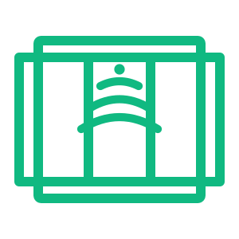

# Auto Sliding Door — Control4 DriverWorks Driver

A Control4 experience-button driver for a motion-sensor-enabled sliding door wired with two relays (door-open trigger + motion-sensor arm) and one contact sensor (door position). One device, three sustained modes, full programming surface.

<table>
  <tr>
    <td align="center"><br><b>Off</b><br>Door closed<br>Motion disarmed</td>
    <td align="center"><br><b>Hold</b><br>Door held open<br>Motion disarmed</td>
    <td align="center"><br><b>Auto</b><br>Door closed<br>Motion sensors armed</td>
  </tr>
</table>

## Why this driver

A sliding door with a built-in motion-detection module is typically wired into Control4 with three signals:

| Wire | Direction | Behavior |
|---|---|---|
| **Open Door relay** | C4 → door | Closed = slide open. Open = slide closed. Hold closed to keep open. |
| **Arm Motion relay** | C4 → door | Closed = motion sensors armed. They then trigger door open on their own. |
| **Door Contact sensor** | door → C4 | Reports actual door position. |

Without this driver, an integrator typically exposes each relay as a standalone device and writes ad-hoc programming on top. The result is three loosely-coupled controls that don't reflect mode as a first-class concept.

This driver collapses the whole thing into one experience button with a real state model — `Off / Hold / Auto` as the canonical mode, plus a one-shot `Open for N Seconds` action — and gives programming clean hooks (Events, Conditions, Actions, Variables) to react to mode changes from announcements, lights, voice, scenes, or physical buttons.

## Features

- **Three sustained modes** (Off / Hold / Auto) with a single canonical state variable
- **Open Door for N Seconds** action with reset-on-retrigger semantics
- **Built-in gesture decoder** — wire a physical button's Press and Release events to two actions and you get single / double / long-press behavior with zero custom timers or variables
- **Mode-aware Navigator tile** — icon swaps gray / amber / green
- **Keypad LED integration** — bound keypad button LEDs auto-recolor per mode (configurable)
- **Door-position aware** — consumes the contact sensor, fires `Door Opened` / `Door Closed` events, optional `Still Open` watchdog
- **Tunable everything** — default open duration, Hold auto-release timer, contact debounce, gesture thresholds, per-mode colors
- **Relay & contact inversion** — works with both NO and NC wiring
- **Composer-friendly** — BUTTON_LINK targets for keypad-drag binding (optional), full conditional/variable surface for IF programming

## Hardware requirements

- Control4 OS 2.9.0 or later
- A controller with at least 2 relay outputs and 1 contact-sensor input available
- The sliding door must accept dry-contact closures on both control inputs (open trigger + motion-arm) and provide a dry-contact position sensor

The driver is hardware-agnostic on relay and sensor implementation — wire it to whatever physical relays/sensors your controller exposes.

## Install

### Option A — download a release

1. Grab `autoslidingdoor.c4z` from the latest [release](../../releases) (or build from source — below)
2. Composer → **System Design → Search Drivers → Add Driver from File** → pick the `.c4z`
3. Drag the new **Auto Sliding Door** driver into a room
4. Wire connections (see below)
5. Show it in Navigator: **Room Properties → Navigator Tab → Device Visibility**

### Option B — build from source

```sh
git clone https://github.com/mattstein111/control4-autoslidingdoor.git
cd control4-autoslidingdoor
./build.sh
```

Produces `autoslidingdoor.c4z` at the repo root. Then follow Option A from step 2.

Build dependencies: `zip`, `xmllint`, `luac`. Re-rendering icons additionally needs `rsvg-convert` (`brew install librsvg`).

## Wiring

In **Composer → Connections → Control/AV**:

| Connection | Bind to | Required |
|---|---|---|
| `Open Door Relay` | The physical relay output controlling the door's open trigger | **Yes** |
| `Arm Motion Relay` | The physical relay output that arms the door's built-in motion sensors | **Yes** |
| `Door Contact` | The contact sensor on the door | Recommended (without it, `DOOR_STATE` stays `Unknown` and door events don't fire) |
| `Open` / `Off` / `Hold` / `Auto` (BUTTON_LINK) | A keypad button you want auto-bound to that action | Optional |

The BUTTON_LINK targets are for integrators who prefer Composer's drag-to-bind workflow on keypad buttons. They're `autobind=False`, so they're invisible unless you actively use them. Most installations put programming directly on a button press and call the driver's Actions, which is more flexible.

## Quick start: drive the door from a physical button

The driver includes a built-in gesture decoder that handles single / double / long-press detection internally. The minimal programming you need on your keypad button:

| Keypad event | Action to call |
|---|---|
| When Button is **Pressed** | Auto Sliding Door → **On Button Pressed** |
| When Button is **Released** | Auto Sliding Door → **On Button Released** |

That's it. The driver decodes:

| Gesture | Effect |
|---|---|
| Short press (no second within window) → if Mode = Off | **Open Door** (default duration) |
| Short press (no second within window) → if Mode = Hold or Auto | **Set Mode to Off** (releases) |
| Two short presses within Double Click Window | **Set Mode to Auto** |
| Held past Long Press Threshold | **Set Mode to Hold** (fires as soon as threshold elapses, before release) |

Tune via the `Long Press Threshold (ms)` (default 1000) and `Double Click Window (ms)` (default 400) properties.

If you'd rather write your own decoder and call lower-level actions, see [Actions](#actions) below.

## Modes

| Mode | Open Door relay | Arm Motion relay | Door behavior |
|---|---|---|---|
| **Off** | Open | Open | Door closes; motion disarmed |
| **Hold** | Closed | Open | Door slides open and stays open until released (or until `Hold Duration` elapses, if set) |
| **Auto** | Open | Closed | Motion sensors armed — door auto-opens on motion, auto-closes when motion stops |

Both relays are recomputed from state on every transition. The rule is:

```
Open Door relay closed   ⇔   (MODE == Hold)  OR  (Open-for-N timer is running)
Arm Motion relay closed  ⇔   (MODE == Auto)
```

This means Hold and `Open for N` compose cleanly — calling `Open for N` while in Hold is harmless (relay already closed; the timer expires uneventfully). A mode change always recomputes outputs from scratch.

## Actions

All actions are callable from C4 programming, voice, scenes, and keypads.

| Action | Param | Behavior |
|---|---|---|
| `Open Door` | — | Closes Open Door relay for `Default Open Duration` seconds, then releases |
| `Open Door for N Seconds` | `Seconds` | Closes Open Door relay for N seconds (overrides default). Reset-on-retrigger semantics |
| `Set Mode to Off` | — | Releases Hold, disarms Auto, cancels any pending open timer |
| `Set Mode to Hold (Hold Open)` | — | Closes Open Door relay continuously. Auto-releases to Off after `Hold Duration` seconds if non-zero |
| `Set Mode to Auto (Motion Sensors)` | — | Closes Arm Motion relay continuously |
| `Cancel Pending Open` | — | Stops an in-flight `Open Door` timer early. Mode unchanged |
| `On Button Pressed` | — | Feeds the built-in gesture decoder. Pair with `On Button Released` |
| `On Button Released` | — | Feeds the built-in gesture decoder |

**Behavior rules:**

- `Set Mode → X` when already in mode X is a **no-op** — no event re-fires, LEDs don't re-flash. Prevents announcement spam.
- Any mode change cancels any pending `Open for N` timer.
- Calling `Open for N` again while a timer is already running **resets** the timer to N from now (intuitive "keep it open longer").

## Events

| Event | Fires when |
|---|---|
| `Mode Changed to Off` | MODE transitions to Off |
| `Mode Changed to Hold` | MODE transitions to Hold |
| `Mode Changed to Auto` | MODE transitions to Auto |
| `Door Opened` | Door contact sensor reports open (post-debounce) |
| `Door Closed` | Door contact sensor reports closed (post-debounce) |
| `Still Open` | Door has been open continuously longer than `Still Open Time` (only if > 0) |

## Conditions

For Composer "If…" programming blocks:

- `Mode is [Off / Hold / Auto]`
- `Door State is [Open / Closed / Unknown]`

## Variables

| Variable | Type | Values |
|---|---|---|
| `MODE` | string | `Off` / `Hold` / `Auto` |
| `DOOR_STATE` | string | `Open` / `Closed` / `Unknown` |

## Properties

| Property | Type | Default | Range |
|---|---|---|---|
| Debug Mode | List | Off | Off / On |
| Default Open Duration (s) | Integer | 5 | 1–600 |
| Hold Duration (s) | Integer | 0 (unlimited) | 0–3600 |
| Still Open Time (s) | Integer | 0 (disabled) | 0–3600 |
| Long Press Threshold (ms) | Integer | 1000 | 200–3000 |
| Double Click Window (ms) | Integer | 400 | 100–1000 |
| Door Contact Debounce (ms) | Integer | 250 | 1–1000 |
| Invert Open Door Relay | List | No | Yes/No |
| Invert Arm Motion Relay | List | No | Yes/No |
| Invert Door Contact | List | No | Yes/No |
| Off LED Color | Color | `0,0,200` (blue) | Color picker |
| Hold LED Color | Color | `200,200,0` (amber) | Color picker |
| Auto LED Color | Color | `0,200,0` (green) | Color picker |
| Mode (readonly) | String | `Off` | — |
| Door State (readonly) | String | `Unknown` | — |
| Contact Status (readonly) | String | auto | — |
| Driver Version (readonly) | String | auto | — |

## Programming recipes

### React to mode changes (announcements, lights, etc.)

In Composer Programming, under each `Mode Changed to X` event of the driver:

```
When Auto Sliding Door → Mode Changed to Hold:
  - Annunciator → Play "Door held open"
  - Hue Light "Hallway" → Set color to amber

When Auto Sliding Door → Mode Changed to Auto:
  - Annunciator → Play "Door is now automatic"
  - Hue Light "Hallway" → Set color to green

When Auto Sliding Door → Mode Changed to Off:
  - Annunciator → Play "Door off"
  - Hue Light "Hallway" → Set color to blue
```

### Watchdog: nag if door is left open

Set `Still Open Time (s)` to 300 (5 minutes). Then:

```
When Auto Sliding Door → Still Open:
  - Annunciator → Play "The sliding door has been open for 5 minutes"
```

### Doorbell triggers a timed open

```
When Doorbell → Pressed:
  - If Auto Sliding Door → Mode is Off:
    - Auto Sliding Door → Open Door for 10 Seconds
```

(In Auto/Hold the door is already open or autonomously responsive, so the conditional avoids a redundant relay pulse.)

### Voice — "Open the back door"

Bind a voice intent to the `Open Door` action. The driver handles the rest using the configured default duration.

## How it works

```
                   ┌────────────────────────────┐
   On Button       │     gesture decoder        │
   Pressed/Released├────────────────────────────┤
   ────────────►   │ short/double/long detector │──┐
                   └────────────────────────────┘  │
                                                   ▼
   Open Door       ┌───────────────┐         ┌────────┐    Open Door relay
   ──────────────► │ Open-for-N    │────────►│ relay  │──► closed if Hold OR
   Cancel Open ──► │ timer         │      ┌─►│ recalc │    open timer active
                   └───────────────┘      │  └────────┘
                                          │
                   ┌───────────────┐      │  ┌────────┐    Arm Motion relay
   Set Mode  ────► │   SetMode     │──────┼─►│ relay  │──► closed iff
   to X            │ (single path) │      │  │ recalc │    MODE == Auto
                   └───────┬───────┘      │  └────────┘
                           │              │
                           ▼              │
                   ┌───────────────┐      │
                   │ MODE variable │──────┘
                   │ + Navigator   │
                   │ tile + LEDs   │
                   │ + history     │
                   │ + events fire │
                   └───────────────┘

   Contact sensor ────► debounce ────► DOOR_STATE variable
                                       + Door Opened/Closed events
                                       + Still-Open watchdog
```

**Key design decisions:**

- **Relays are derived state, not driven directly.** Every transition recomputes both relays from scratch using `MODE` and the open-timer state. This eliminates whole classes of state-divergence bugs.
- **One state-transition function (`SetMode`).** Idempotent; fires events only on actual transition; cancels relevant timers.
- **Gesture decoder is internal.** The caller (your physical button programming) doesn't see timers or variables — just two actions.
- **Director restart = safe defaults.** Driver wakes up in Off with both relays released. No "restore last mode" behavior to surprise you after maintenance.

Full design rationale: [`docs/superpowers/specs/2026-05-26-auto-sliding-door-experience-button-design.md`](docs/superpowers/specs/2026-05-26-auto-sliding-door-experience-button-design.md).

## Troubleshooting

Set the **Debug Mode** property to `On`. Verbose output then prints to Composer's Lua Output pane with `[autoslidingdoor]` prefix on every action, timer, mode change, and gesture decision. Example:

```
[autoslidingdoor] gesture: PRESSED
[autoslidingdoor] gesture: RELEASED  (long_press_fired=false  waiting_for_double=false)
[autoslidingdoor] gesture -> SINGLE PRESS (from Off) -> Open Door
[autoslidingdoor] OpenForN 5 s
[autoslidingdoor] relay 100 -> CLOSE
[autoslidingdoor] open timer expired
[autoslidingdoor] relay 100 -> OPEN
```

Common issues:

- **Mode-changed event doesn't fire** — check that the mode actually transitioned. Setting the same mode that's currently active is intentionally a no-op.
- **Door state stays `Unknown`** — the `Door Contact` connection isn't wired. Check `Contact Status` property.
- **Navigator tile icon doesn't swap** — the `<navigator_display_option>` state IDs must match what the driver sends via `ICON_CHANGED`. Should be `Mode_Off` / `Mode_Hold` / `Mode_Auto`.
- **Keypad LEDs don't update** — verify the keypad button is bound to one of the BUTTON_LINK connections (Open / Off / Hold / Auto). The LED-color command depends on the keypad's button proxy supporting `BUTTON_COLORS`.

## Repository layout

```
control4-autoslidingdoor/
├── driver.xml                     # Composer-facing manifest
├── driver.lua                     # Runtime logic (Lua 5.1)
├── build.sh                       # Builds autoslidingdoor.c4z
├── README.md                      # This file
├── CHANGELOG.md
├── src/icons/
│   ├── mode_off.svg               # Source SVGs (gray closed door)
│   ├── mode_hold.svg              # (amber open w/ pause bar)
│   ├── mode_auto.svg              # (green open w/ motion arcs)
│   └── render.sh                  # Renders PNG ladders via rsvg-convert
├── www/
│   ├── documentation.html         # In-Composer help text
│   └── icons/                     # Pre-rendered PNGs (committed)
└── docs/
    └── superpowers/specs/         # Design specs
```

## Building

```sh
./build.sh
```

Validates `driver.xml` (xmllint) and `driver.lua` (luac), then zips into `autoslidingdoor.c4z` at the repo root. The zip excludes `.DS_Store`, dotfiles, and source SVGs.

To regenerate icons after editing the SVGs:

```sh
./src/icons/render.sh
```

## Manual test plan

A full installable-acceptance checklist is in the [design spec](docs/superpowers/specs/2026-05-26-auto-sliding-door-experience-button-design.md#12-manual-test-plan-run-after-each-c4z-rebuild). Run through it after each rebuild.

## Versioning

The `<version>` in `driver.xml` is a monotonic integer derived from `git rev-list --count HEAD` (per Control4 conventions — date-based versions overflow Composer's int). `<modified>` is set to the build date.

Future auto-update via GitHub Releases (per the unlock pattern at [`~/.claude/c4-conventions.md`](https://github.com/mattstein111/claude-code-setup) §3a) is scaffolded but not enabled in v2.

## Credits

- Patterns for `uibutton` proxy, `<navigator_display_option>` state-icon swapping, `BUTTON_LINK` keypad-drag targets, and `RecordHistory` integration are borrowed from Control4's stock `door_relay_control` (OS2.9+) driver
- Icon packaging, hot-reload SOAP, and `FileSetDir` handshake patterns from [`~/.claude/c4-conventions.md`](https://github.com/mattstein111/claude-code-setup)
- The unlock for unsigned-driver file-write capability is the original esphome handshake by Derek Miller / finitelabs ([control4-esphome](https://github.com/finitelabs/control4-esphome))

## License

MIT
